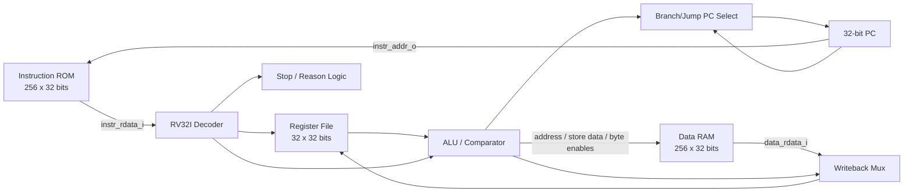

# OpenRV32 architecture — v0.2 prototype

This is a **single-cycle datapath**, not a pipeline. The simulation harness supplies two separate combinational memory ports; there is no shared bus or memory latency.

## CPU ports

| Port | Dir | Width | Meaning |
|---|---|---:|---|
| `clk_i` | in | 1 | Clock |
| `rst_ni` | in | 1 | Active-low asynchronous reset |
| `instr_addr_o` | out | 32 | Instruction byte address (PC) |
| `instr_rdata_i` | in | 32 | Instruction word at PC |
| `data_valid_o` | out | 1 | Data access required (0 for faults/halts) |
| `data_we_o` | out | 1 | Write intent for data access |
| `data_wstrb_o` | out | 4 | Byte enables for stores |
| `data_addr_o` | out | 32 | Data byte address |
| `data_wdata_o` | out | 32 | Shifted store data, lane-aligned |
| `data_rdata_i` | in | 32 | Aligned memory word containing addressed lane |
| `halted_o` | out | 1 | Stops further architectural updates when asserted |
| `halt_reason_o` | out | 3 | Implementation-specific reason, see below |

All data values use little-endian byte order. A data access may be performed only while `data_valid_o` is high. The memory array index is `data_addr_o[9:2]`, with byte lane `data_addr_o[1:0]`. The SoC aborts any out-of-bounds store; it does not emulate an access-fault trap.

## Halt reasons (prototype-specific)

| Code | Event |
|---:|---|
| 0 | Executing normally |
| 1 | EBREAK (test-program terminator) |
| 2 | ECALL |
| 3 | Illegal/unsupported instruction encoding |
| 4 | Misaligned load/store |
| 5 | Misaligned next PC |

Halting is **not** an architecturally compliant RISC-V exception implementation. On a stop condition, register writes and memory writes are suppressed. `halted_o` and the reason stay latched until reset.

## Implemented instructions

- `LUI`, `AUIPC`, `JAL`, `JALR`
- `BEQ`, `BNE`, `BLT`, `BGE`, `BLTU`, `BGEU`
- `LB`, `LH`, `LW`, `LBU`, `LHU`; `SB`, `SH`, `SW`
- `ADDI`, `SLTI`, `SLTIU`, `XORI`, `ORI`, `ANDI`, `SLLI`, `SRLI`, `SRAI`
- `ADD`, `SUB`, `SLL`, `SLT`, `SLTU`, `XOR`, `SRL`, `SRA`, `OR`, `AND`
- `FENCE` is modeled as an in-order no-op; `ECALL` and `EBREAK` halt.

## Next architecture changes

Introduce explicit fetch/decode, execute, memory, writeback stage boundaries; bus readiness and stalls; architectural exception/trap controller and CSRs; ISA tests; randomized verification; finally an FPGA-friendly memory/peripheral system. See [roadmap](roadmap.md).
